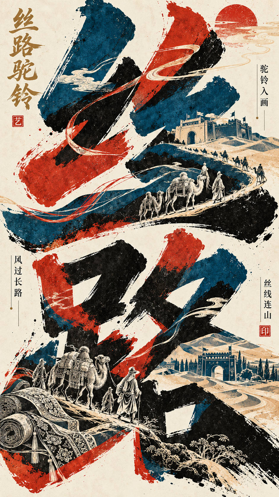
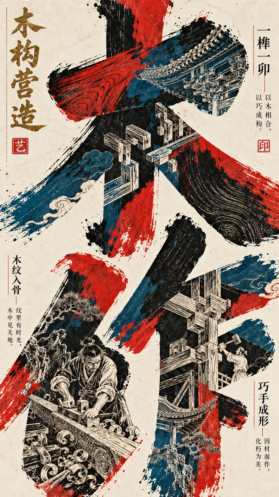
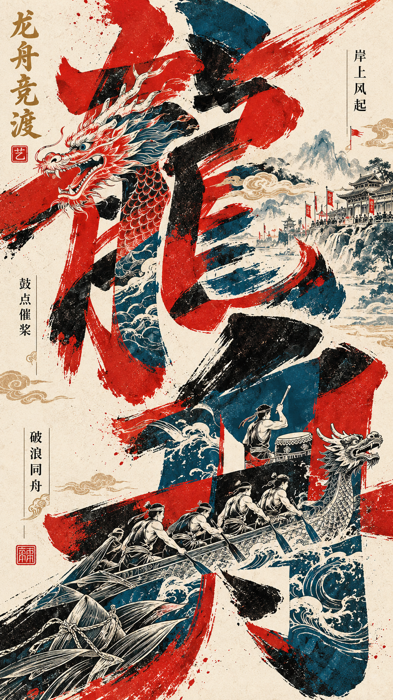
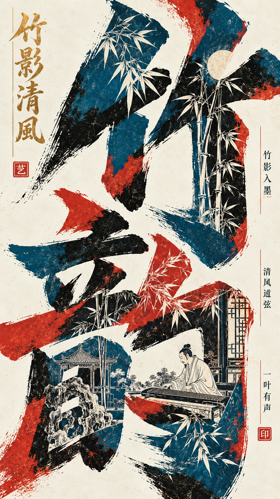
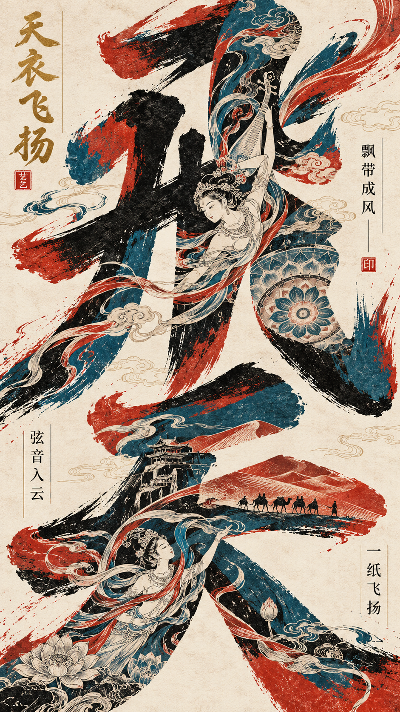
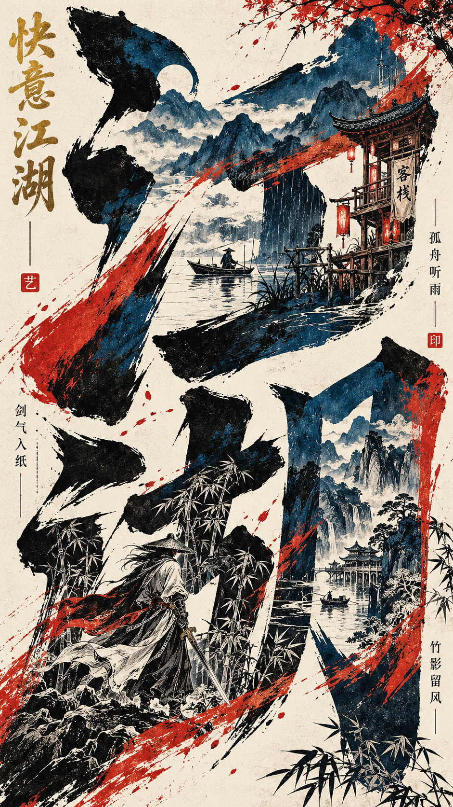
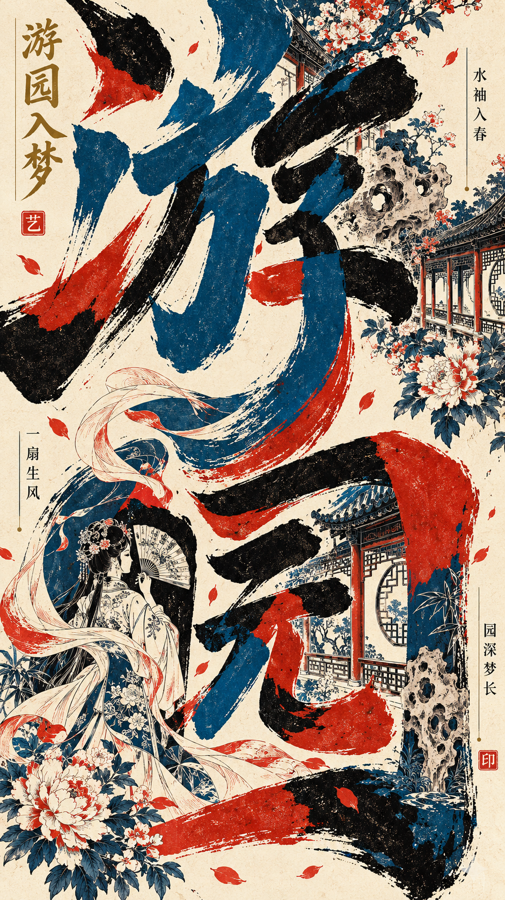
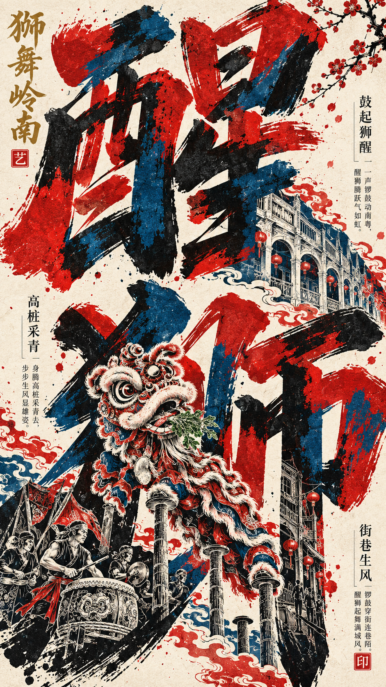

# 巨型书法解构·东方套色实验字体海报 Skill / Giant Calligraphy Print Poster Skill

## 作品展示 · Gallery

以下海报均由本 Skill 生成。

| | | | |
|---|---|---|---|
|  |  |  |  |
|  |  |  |  |

## 它能做什么
- 两个核心汉字放大到画面高度约 80%，拉伸、交错、出画但仍可读
- 三色有机色块在笔画内部穿插嵌套，丝网印刷质感
- 左上古金竖排题名 + 英文副标题 + 多组微型题跋与朱红印章
- 画面下方 1/3 的白描人物与建筑嵌入巨字内部，木刻版画效果
- 只给主题也能用：自动选字、拟题名与题跋，不编造引文

## 安装
**作为 Agent Skill（Claude Code / Cursor / Codex 等）**：

```bash
git clone https://github.com/ericchan916/giant-calligraphy-print-poster-skill.git
cp -r giant-calligraphy-print-poster-skill ~/.claude/skills/giant-calligraphy-print-poster
# 或 ~/.cursor/skills/、~/.codex/skills/ 等
```

**在 ChatGPT / 其他图像模型中使用**：复制 [`prompt.md`](prompt.md) 里的完整提示词，填入字段即可。

## 使用示例
```
【主题】：岭南醒狮
【核心汉字】：醒、狮
```
或只写：`【主题】：武侠江湖`

更多示例见 [`examples/themes.md`](examples/themes.md)。

## 默认配色
| 颜色 | 用途 |
|---|---|
| 朱红 | 主色块、印章 |
| 青蓝 | 主色块 |
| 墨黑 | 主色块、笔画 |
| 暖米白 | 背景、留白、白描线 |
| 古金（少量） | 竖排书法题名 |

## English
**Giant Calligraphy Print Poster** creates one 9:16 Eastern experimental typography poster: two giant deconstructed brush characters, vermilion / cyan-blue / ink-black registration-print blocks, micro vertical inscriptions and seals, and white baimiao scenes embedded inside the characters. Copy the folder into your agent's skills directory, or paste `prompt.md` into ChatGPT or any image model.

## License
MIT © 2026 Joy Robinson — 见 [LICENSE](LICENSE)。生成图片的使用请同时遵守你所用图像模型的服务条款。
